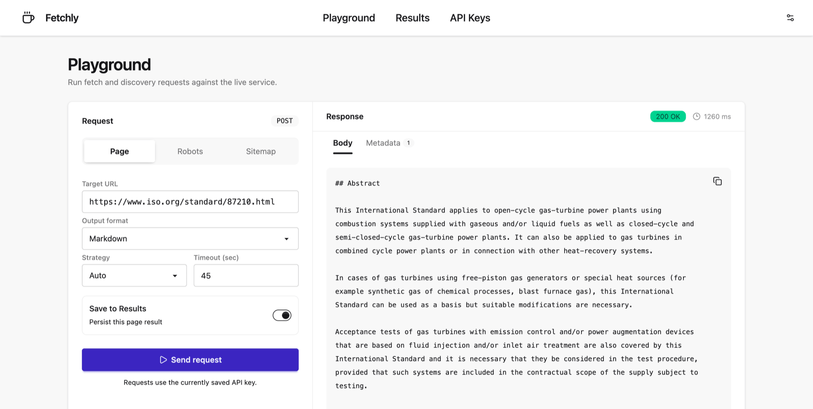
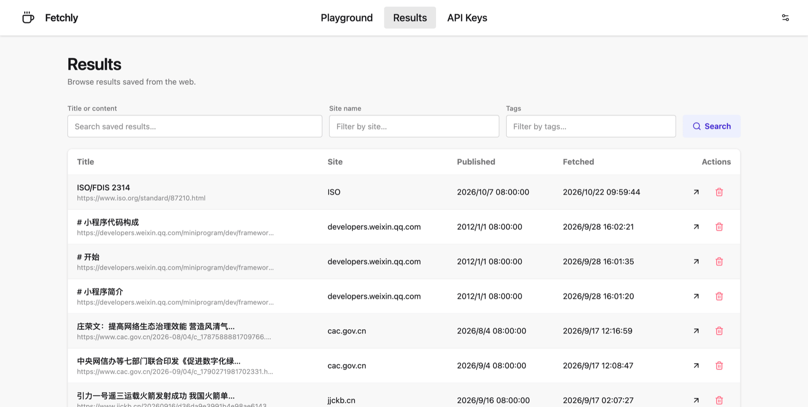
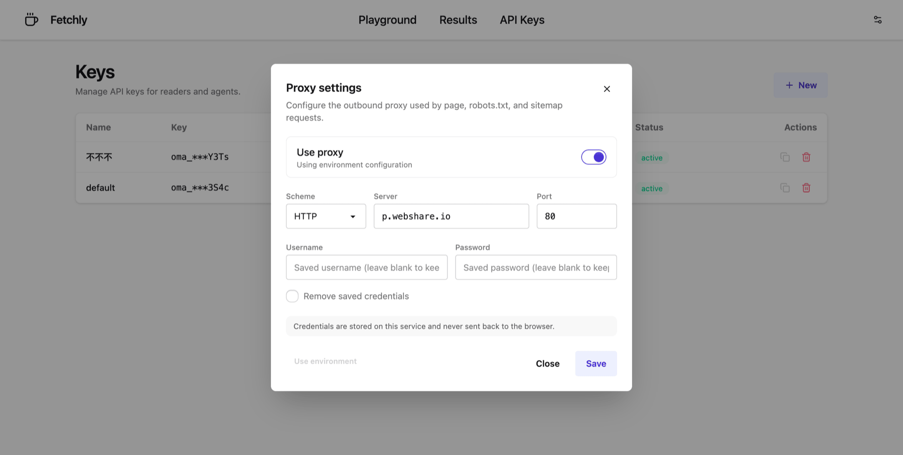
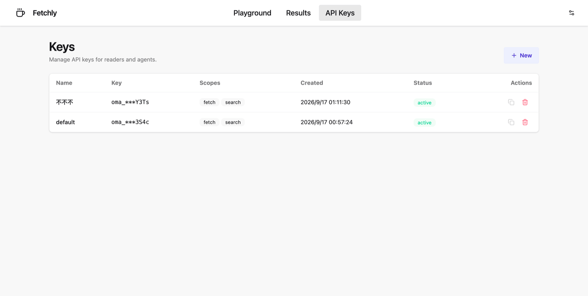

# OMA Fetcher

[English](README.md) · **简体中文**

[](LICENSE)
[](https://www.python.org/downloads/)
[](https://github.com/wyf0931/oma-fetcher/pkgs/container/oma-fetcher)
[](https://github.com/wyf0931/oma-fetcher/releases)

OMA Fetcher 是一个面向单个 URL 的 **网页阅读与发现 API**。它可以把一个 URL
转换为干净的 Markdown、文本、JSON 或 XML，读取 `robots.txt`，发现 sitemap
中的页面 URL，并可将文档持久化到本地 SQLite 文库。

它适合需要稳定获取网页内容的 Agent 和工具，调用方无需自带浏览器自动化框架。

> 本文档为中文译本。若与英文文档存在差异，以 [英文 README](README.md) 为准；
> 详细文档目前以英文维护。

## 功能特性

- **一个 URL 输入，干净内容输出** —— 使用 Trafilatura 提取，支持
  `markdown`、`txt`、`json`、`xml` 四种格式。
- **渐进式失败回退** —— `httpx` → `curl-cffi` → Scrapling 隐身模式 →
  Playwright，共享同一超时预算。
- **内容感知评估** —— 区分文章、列表卡片、robots/sitemap 文档、
  Cookie/浏览器兼容提示以及反爬占位页。
- **robots 与 sitemap 发现** —— 获取原始 `robots.txt`，并在限制范围内展开
  sitemap。
- **可选持久化与搜索** —— SQLite 文档库，使用 jieba + FTS5 搜索；抓取默认
  不落库，需显式开启。
- **安全默认值** —— 默认拒绝私有/回环地址，并遵守 robots 规则。
- **本地 Web UI** —— 在 Playground 中发请求、浏览文档库、管理 API Key。
- **MCP 服务器** —— 在 `/mcp` 提供 Streamable HTTP 工具，复制一段 JSON 即可接入任意 MCP 客户端。
- **单容器部署** —— 已发布到 GHCR，内置 Chromium 与全部抓取策略。

## 界面截图

| Playground | Results |
| :---: | :---: |
| [](docs/assets/screenshots/playground.png) | [](docs/assets/screenshots/results.png) |
| 运行 fetch、robots 和 sitemap 请求，并查看完整响应。 | 浏览、筛选并打开已保存文档。 |
| **代理设置** | **API Keys** |
| [](docs/assets/screenshots/proxy-settings.png) | [](docs/assets/screenshots/keys.png) |
| 无需重启服务即可覆盖出站代理。 | 创建、复制和撤销带作用域的客户端 Key。 |

截图使用本地演示数据。

## 工作原理

```text
robots.txt / sitemap discovery
              ↓
httpx → curl-cffi → Scrapling → Playwright
              ↓
    content assessment + Trafilatura extraction
              ↓
   markdown / txt / json / xml (+ optional SQLite)
```

所有响应使用统一信封：

```json
{"code": 0, "message": "ok", "data": "...", "meta": {}}
```

`code: 0` 表示成功。失败时 `data` 为 `null`，`message` 和
`meta.attempts` 会说明原因。

## 快速开始

### macOS 一键安装

在全新的 macOS 机器上，安装脚本仅在缺失时安装 Homebrew、Git、Docker
CLI/Compose 和 Colima，启动 Colima，并拉取已发布镜像。它不会在本地构建镜像。

```sh
curl -fsSL https://raw.githubusercontent.com/wyf0931/oma-fetcher/main/scripts/install-macos.sh | bash
```

服务和 Web UI 位于 `http://127.0.0.1:7890`（UI 为 `/`，API 文档为 `/docs`）。
安装选项和安全覆盖参数见[部署文档](docs/deployment.md)。

### Docker Compose

```sh
cp .env.example .env
docker compose pull
docker compose up -d
curl -sS http://127.0.0.1:7890/healthz | jq
```

### 本地 Python 开发

需要 Python 3.12+ 和 [uv](https://docs.astral.sh/uv/)。

```sh
uv sync
uv run uvicorn app.main:app --host 127.0.0.1 --port 7890
```

也可以同时管理 API 和 Web UI：

```sh
bin/ops.sh start                 # http://127.0.0.1:7890
bin/ops.sh status
bin/ops.sh stop
```

## 使用方式

### 抓取页面

默认输出 Markdown。

```sh
curl -sS -X POST 'http://127.0.0.1:7890/api/fetch?persist=true' \
  -H 'Content-Type: application/json' \
  -d '{
    "url": "https://www.iso.org/standard/87210.html",
    "output_format": "markdown",
    "timeout_seconds": 90
  }' \
  | jq -e 'if .code == 0 then .data else error(.message) end'
```

只查看抓取决策，不打印正文：

```sh
curl -sS -X POST 'http://127.0.0.1:7890/api/fetch' \
  -H 'Content-Type: application/json' \
  -d '{"url":"https://www.iso.org/standard/87210.html","timeout_seconds":90}' \
  | jq '{code, message, strategy: .meta.strategy, attempts: .meta.attempts}'
```

持久化默认关闭。可使用 `?persist=true`、`Prefer: persist` 或
`STORAGE_SAVE_DEFAULT=on`；查询参数优先级最高。成功响应还会在
`meta.page` 中返回 Trafilatura 提取的页面元数据。

### 读取 robots.txt 与 sitemap

```sh
curl -sS --get 'http://127.0.0.1:7890/api/robots' \
  --data-urlencode 'url=https://www.iso.org/' \
  | jq -e 'if .code == 0 then .data else error(.message) end'
```

```sh
curl -sS --get 'http://127.0.0.1:7890/api/sitemap' \
  --data-urlencode 'url=https://www.iso.org/sitemap/standard.xml' \
  | jq -e 'if .code == 0 then .data | fromjson[:20][] else error(.message) end'
```

### 搜索文档库

```sh
curl -sS -X POST 'http://127.0.0.1:7890/api/search' \
  -H 'Content-Type: application/json' \
  -d '{"query":"国家标准 外文版","limit":20}' | jq
```

## API

| 端点 | 用途 |
| --- | --- |
| `POST /api/fetch` | 抓取单个 URL，提取 Markdown、文本、JSON 或 XML。 |
| `POST /api/search` | 使用 jieba + FTS5 搜索已持久化文档。 |
| `GET /api/documents` | 分页列出文档，支持过滤。 |
| `GET /api/documents/{id}` | 读取单个文档及其抓取历史。 |
| `DELETE /api/documents/{id}` | 删除文档。 |
| `GET /api/robots?url=…` | 读取站点原始 `robots.txt`。 |
| `GET /api/sitemap?url=…` | 将 sitemap 展开为页面 URL。 |
| `GET/PUT/DELETE /api/settings/proxy` | 查看或覆盖代理设置。 |
| `POST/GET/DELETE /api/keys` | 管理客户端 API Key。 |
| `GET /livez`、`/readyz`、`/healthz`、`/health` | 存活与就绪探针。 |

完整请求字段、响应元数据和错误码见 [API Reference](docs/api-reference.md)。

## Web UI

打开 `http://127.0.0.1:7890/` 进入 Fetchly Web UI。它提供 Playground、Results 和 API Keys 页面、
Bearer Key 复用、表格过滤/分页、文档详情/删除，以及 Key 创建/复制/删除。
代理设置可在设置面板中修改，无需重启服务；旁边的插头图标可查看并复制 MCP 客户端配置。

## MCP 服务器

运行中的服务同时是 MCP 服务器，通过 `/mcp` 提供 Streamable HTTP。先运行
`bin/ops.sh start`，然后把下面配置加入任意 MCP 客户端（顶部插头图标会显示
相同 JSON 并提供复制按钮）：

```json
{
  "mcpServers": {
    "fetchly": {
      "type": "http",
      "url": "http://127.0.0.1:7890/mcp"
    }
  }
}
```

工具：`fetchly_web_fetch`、`fetchly_robots`、`fetchly_sitemap`、
`fetchly_search_results`、`fetchly_list_results`、`fetchly_get_result`。
stdio 配置、认证方式和完整工具契约见 [MCP 服务器](docs/mcp.md)。

## 配置

复制 `.env.example` 为 `.env`，只修改需要的项。常用配置：

| 变量 | 默认值 | 用途 |
| --- | --- | --- |
| `FETCHER_ENFORCE_ROBOTS` | `true` | 页面抓取遵守 robots 规则。 |
| `FETCHER_ALLOW_PRIVATE_NETWORKS` | `false` | 允许私有/回环地址。 |
| `STORAGE_SAVE_DEFAULT` | `off` | 默认持久化所有抓取。 |
| `FETCH_ROUTE_TTL_HOURS` | `168` | 按主机名和目标类型的路由缓存时长。 |
| `PROXY_ENABLED` / `PROXY_URL` | `off` / 空 | 让所有策略走代理。 |
| `API_AUTH_ENABLED` | `off` | 要求 `/api/*` 使用 Bearer 认证。 |
| `API_ADMIN_KEY` / `API_KEY_PEPPER` | 空 | 管理员令牌与 Key 哈希 Pepper。 |
| `API_DOCS_ENABLED` | `true` | 提供 `/docs` 和 `/redoc`。 |

全部变量、持久化优先级、代理覆盖和认证配置见
[Configuration](docs/configuration.md)。

## 部署

已发布镜像为 `ghcr.io/wyf0931/oma-fetcher`。部署时从 GitHub Container
Registry 拉取，而不是本地构建。

```sh
docker compose pull
docker compose up -d
docker compose logs -f fetcher
```

启用认证后健康探针仍保持匿名。进程存活使用 `/livez`，服务就绪使用
`/readyz`。镜像标签、升级、回滚、Colima 和安全加固见
[Deployment](docs/deployment.md)。

## 失败回退与可观测性

HTTP 成功不等于内容成功。`/api/fetch` 会从 `httpx` 逐级升级到 `curl-cffi`、
Scrapling 隐身模式和 Playwright；当 Trafilatura 无法提取有效正文时也会升级。
成功路由会按主机名和目标类型缓存七天。

响应中的 `meta.attempts` 和 `meta.failback` 提供诊断信息。如果客户端打印出
`null`，应检查完整信封，而不是把它当作正文。评估规则、发现重试和排障表见
[Failback and observability](docs/failback.md)。

## 文档

| 文档 | 内容 |
| --- | --- |
| [README.md](README.md) | English documentation |
| [docs/api-reference.md](docs/api-reference.md) | 端点、字段、格式、错误码。 |
| [docs/mcp.md](docs/mcp.md) | MCP 配置 JSON、工具、认证、远程访问。 |
| [docs/configuration.md](docs/configuration.md) | 环境变量、存储、代理、认证。 |
| [docs/deployment.md](docs/deployment.md) | 安装、Docker、升级、健康检查、安全。 |
| [docs/failback.md](docs/failback.md) | 升级链路、内容评估、诊断。 |
| [CONTRIBUTING.md](CONTRIBUTING.md) | 开发环境、测试、项目结构。 |
| [.agents/skills/oma-fetcher/SKILL.md](.agents/skills/oma-fetcher/SKILL.md) | Agent 快速上手与 curl 工作流。 |

## 第三方许可证

OMA Fetcher 使用 MIT 许可证。主要依赖与内置浏览器资源采用以下许可证：

| 组件 | 许可证 | 用途 |
| --- | --- | --- |
| [Python](https://www.python.org/) 3.12+ | PSF-2.0 | 运行时。 |
| [FastAPI](https://github.com/fastapi/fastapi) / [Pydantic](https://github.com/pydantic/pydantic) | MIT | HTTP API 与数据模型。 |
| [Uvicorn](https://github.com/Kludex/uvicorn) / [Starlette](https://github.com/Kludex/starlette) | BSD-3-Clause | ASGI 服务器与框架。 |
| [HTTPX](https://github.com/encode/httpx) | BSD-3-Clause | HTTP/2 与 SOCKS 支持。 |
| [curl-cffi](https://github.com/lexiforest/curl_cffi) | MIT | 浏览器指纹模拟 HTTP。 |
| [Playwright](https://github.com/microsoft/playwright-python) | Apache-2.0 | 浏览器渲染。 |
| [Scrapling](https://github.com/D4Vinci/Scrapling) | BSD-3-Clause | 隐身抓取与解析。 |
| [Trafilatura](https://github.com/adbar/trafilatura) | Apache-2.0 | 正文提取与元数据。 |
| [Beautiful Soup](https://www.crummy.com/software/BeautifulSoup/) | MIT | HTML 解析。 |
| [jieba](https://github.com/fxsjy/jieba) | MIT | FTS 中文分词。 |
| [PrismJS](https://prismjs.com/)（内置） | MIT | JSON 语法高亮。 |
| [Lucide](https://lucide.dev/)（内置） | ISC | UI 图标。 |

传递依赖仍遵循各自许可证。重新分发容器镜像时，请保留这些软件包附带的
许可证声明。

## 参与贡献

欢迎提交 Issue 和 Pull Request。提交前请运行 `uv run pytest -q`，保持
`README.md` 与 `README.zh-CN.md` 同步，并且不要提交 `.env`、数据库或凭据。
详见 [CONTRIBUTING.md](CONTRIBUTING.md)。

## 许可证

[MIT](LICENSE) © 2026 Scott
